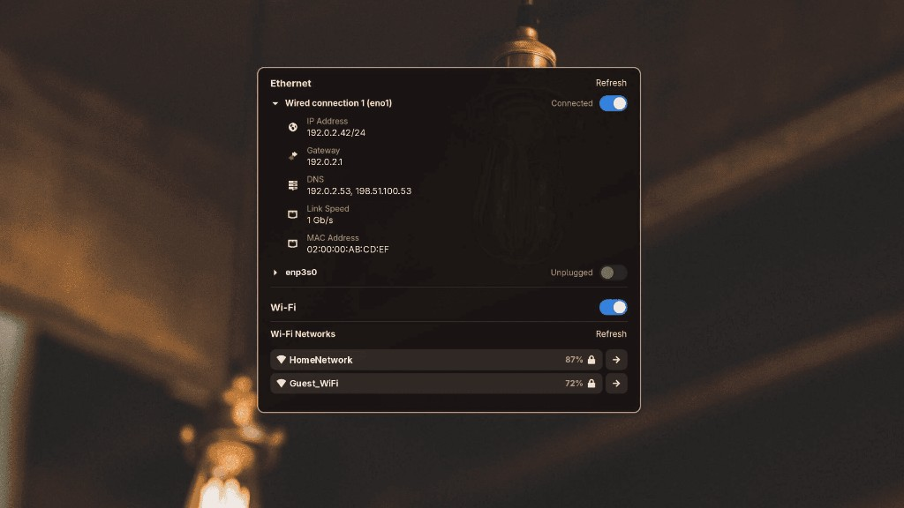

<h1 align="center">nmwire</h1>

A small GTK4 panel for NetworkManager. It lists Wi-Fi and wired links and talks to NetworkManager through `nmcli`.

nmwire is a fork of [nmgui](https://github.com/s-adi-dev/nmgui).



## Features

- GTK4 interface for Wi-Fi and Ethernet
- Uses `nmcli` for backend operations
- One row per Wi-Fi name, with the signal of the link in use
- Wired ports stay collapsed unless they carry the default route
- Optional user style sheet

## Running from source

Python 3.10 or newer, plus:

- `python-gobject` and GTK 4
- `python-nmcli`
- NetworkManager

```bash
git clone https://github.com/Jmartgraphix/nmwire.git
cd nmwire
./nmwire
```

A local virtualenv that can see the system GTK bindings works too. The launcher uses whichever `python3` is on your `PATH`:

```bash
python3 -m venv --system-site-packages .venv
.venv/bin/pip install -r requirements.txt
PATH=".venv/bin:$PATH" ./nmwire
```

## Building a binary

`build/build.bin` compiles `app/main.py` with Nuitka and writes `dist/nmwire`. Install that file as `nmwire` and copy `nmwire.desktop` into the applications directory if you want a menu entry.

## Custom style

If `~/.config/nmwire/style.css` exists, the app loads it instead of the built-in style. When that file is missing, it still loads `~/.config/nmgui/style.css`.

## Hyprland

The window title is `nmwire` and the application id is `com.jmartgraphix.nmwire`. A rule written for the old title `Network Manager` or the class `nmgui` will not match.

```ini
windowrulev2 = float, class:^(com\.jmartgraphix\.nmwire)$
```

## Credits

- [Aditya Pratap Singh](https://github.com/s-adi-dev) — original nmgui
- Aaron Dinesh — user style sheet loading
- [Keo Ponleou Sok](https://github.com/ponleou) — the first Ethernet support
- Jason K Martin — this fork

Network access goes through a fork of python-nmcli: [s-adi-dev/nmcli](https://github.com/s-adi-dev/nmcli).

## License

nmwire stays under the GNU General Public License v3.0. The original grant also allows any later version of that license. The full license text is in [LICENSE](./LICENSE).
